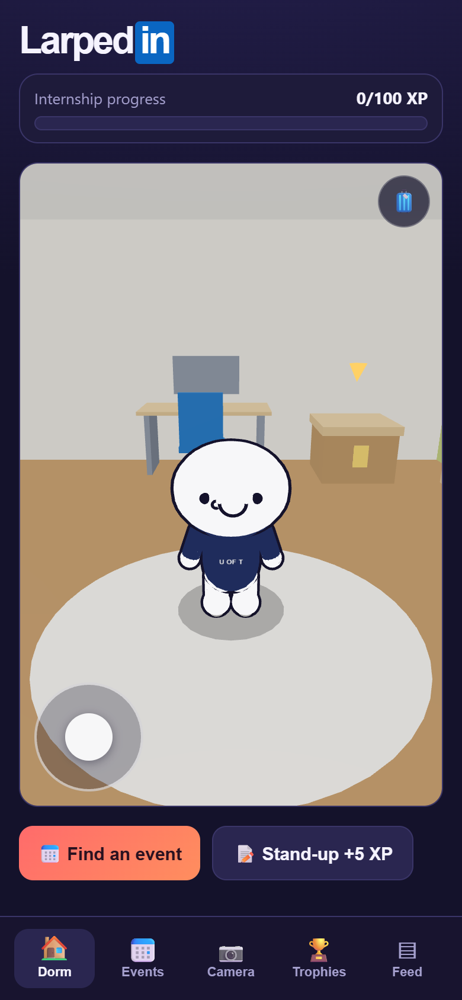
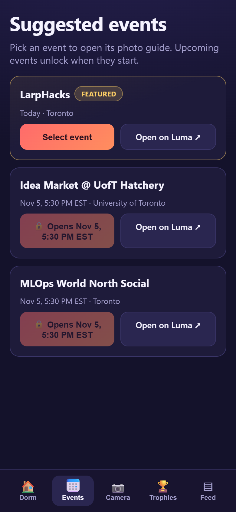
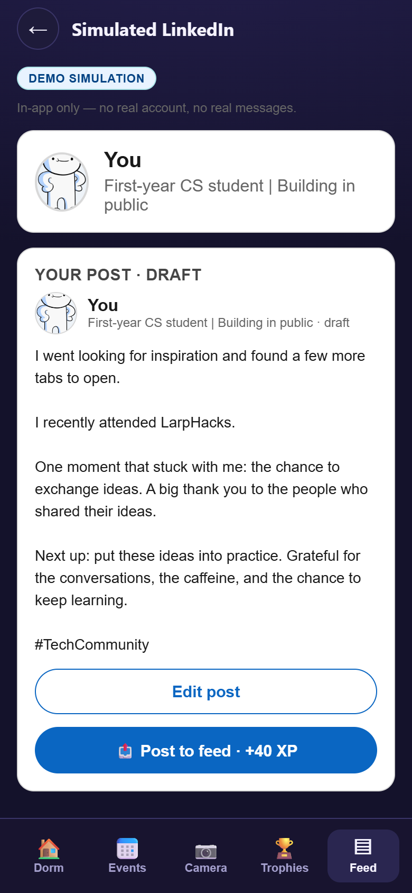
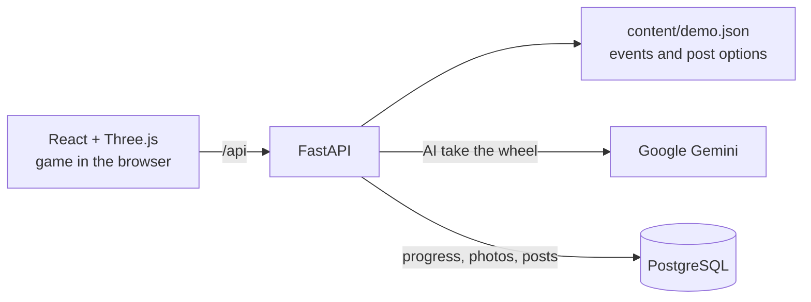

# LarpedIn

**A game built for [LarpHacks](https://larphacks.devpost.com/) that turns the first-year CS hustle into XP.** Walk around your dorm, go to an event, take the mandatory networking photos, generate a cliché LinkedIn post, and earn your way to a "Free recruiter message".




## The problem

First-year CS students are told to network, post, and "build in public" before they've built much at all. Going to an event can start to feel like collecting proof that you went. LarpedIn takes that loop and makes it literal: a game with a progress bar labelled **Internship progress**.

## How it works


| Step                       | What you do                                                           | Internship progress |
| -------------------------- | --------------------------------------------------------------------- | ------------------- |
| 1. **Dorm**                | Walk around a 3D room and dress your character                        | Starts at 0 XP      |
| 2. **Stand-up** (optional) | Log today's win and next step                                         | +5 XP               |
| 3. **Events**              | Pick a real event; LarpHacks is featured                              | +20 XP              |
| 4. **Camera**              | Complete the four prompts: room shot, selfie, event banner, handshake | +10 XP each         |
| 5. **Post composer**       | Fill in the Mad Libs post, or press **AI take the wheel**             |                     |
| 6. **Simulated LinkedIn**  | Publish to the in-app feed                                            | +40 XP              |
| 7. **Gift box**            | Claim your prize: your post and a message go to a fictional recruiter |                     |


Progress along the way also unlocks decor, such as a founder poster and a Google mug, which you can put on your dorm walls and desk.

## Try it in 2 minutes

Open the app on a phone-sized screen if you can, since it's designed for mobile. Enter a name and occupation for your demo profile. Then:

1. **Move around the dorm.** Use the joystick or `W A S D`, and drag to turn the camera.
2. **Open the box.** Walk to the cardboard box with the yellow arrow, then hold `E` or hold the on-screen button. Pick an item and tap a glowing spot to place it.
3. **Change your look.** The briefcase button holds the hoodies.
4. **Go to an event.** Tap **Find an event**, then **Select event** on LarpHacks. Use the camera, or check off the prompts without taking photos.
5. **Write the post.** Press **✨ AI take the wheel**, then **Preview post** and **Post to feed**.
6. **Collect your prize.** Open the gift box and claim it, then check the feed and the recruiter message.

Your progress is saved, so refreshing the page picks up where you left off.

## Tech stack


| Layer              | Technology                        | What it does                                                     |
| ------------------ | --------------------------------- | ---------------------------------------------------------------- |
| **Frontend**       | React 18, TypeScript, Vite        | The mobile-first app and game logic                              |
| **3D**             | Three.js, React Three Fiber, Drei | The walkable dorm and animated character                         |
| **Backend**        | Python, FastAPI, Uvicorn          | Serves event content, writes posts, and hosts the built frontend |
| **AI**             | Google Gemini (`google-genai`)    | Powers **AI take the wheel**                                     |
| **Database**       | PostgreSQL (`psycopg`)            | Saves progress and photos, and stores the shared feed            |
| **Browser camera** | `getUserMedia`                    | Takes the event photos                                           |
| **Deployment**     | Render                            | Hosts the web service and database (`render.yaml`)               |
| **Tests**          | Vitest, pytest                    | Cover game logic and the API                                     |


## How it's built




A few decisions we made on purpose:

- **No sign-up.** You choose a display name and occupation, and the server recognizes you by IP address. Progress and photos are saved in the database under that address. In the local demo, they stay in your browser instead.
- **The AI can't derail the post.** Gemini picks from our curated options and its answer is validated. If there's no API key, or it fails or takes too long, the app picks at random instead.
- **The demo keeps working when things fail.** The `/demo` route runs entirely in the browser with no backend, database, or API key, and the app offers it if the database can't be reached. The camera can always be skipped, and phones that can't run 3D get a flat version of the room.
- **Nothing reaches the real world.** There's no real LinkedIn connection and no real messages. The simulation is labelled as one on screen.


## Run it locally

### Quickest: local demo

This needs only [Node.js 22](https://nodejs.org/), with no backend, database, or API key.

```bash
npm ci --prefix frontend
npm run dev --prefix frontend
```

Then open **http://localhost:5173/demo** (use the port Vite prints if it differs). This route keeps your progress in browser storage, which the browser can clear and which may fill up when storing photos.

### Full app

You'll also need [uv](https://docs.astral.sh/uv/), which installs the correct Python version for you, and a PostgreSQL database. Set `DATABASE_URL` in Terminal 1 before starting the backend.

**Terminal 1: backend, on port 8000**

```bash
cd backend
uv sync
uv run uvicorn app.main:app --reload
```

**Terminal 2: frontend**

```bash
cd frontend
npm install
npm run dev
```

Then open **http://localhost:5173**.

### Environment variables


| Variable         | What it does                                                          |
| ---------------- | --------------------------------------------------------------------- |
| `DATABASE_URL`   | Connects PostgreSQL. Required for the full app, not for `/demo`       |
| `GEMINI_API_KEY` | Optional. Turns on live Gemini; without it, the app picks at random   |


### Run the tests

```bash
cd frontend
npm test

cd ../backend
uv run --with-requirements tests/requirements.txt pytest
```


## Project layout

```text
frontend/src/components/       Screens: dorm, events, camera, composer, simulated LinkedIn
frontend/src/components/room/  3D room, character, movement, and collisions
frontend/src/domain/           Game rules: XP, unlocks, and item placement
backend/app/                   API, post writing, Gemini, and database
content/demo.json              Events and post options
docs/                          Build spec and design decisions
```
